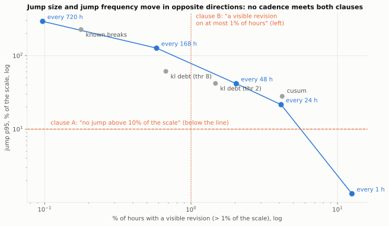
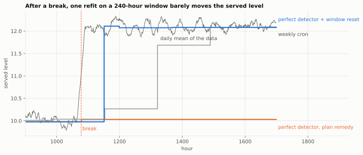
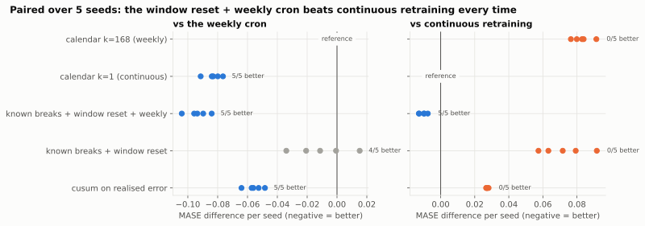

# Block 2: what each retraining policy costs and buys

```bash
uv run w44 harness          # all tables below, about 25 s
```

Code: `src/w44_retraining/{park,model,metrics,harness,harness_study}.py`. Tests: `tests/unit/test_harness.py`,
`tests/integration/test_plan_reproduction.py` (the plan's figures, to the printed digit).

## Notebooks

- [`notebooks/01_the_bench.ipynb`](notebooks/01_the_bench.ipynb): the park, the served model and the closing lag
  made visible, how a policy is scored, the plan's table, the closing-lag illusion, and why stability is two
  incompatible clauses.
- [`notebooks/02_the_perfect_detector.ipynb`](notebooks/02_the_perfect_detector.ipynb): why the perfect detector
  loses (refit timing, seasonal drift switched off, one refit on a 240-hour window), the window-reset remedy,
  paired comparisons over five seeds, and the closed-error CUSUM.







## Setup

A park of 120 hourly series x 2,400 steps (seed 44), served at horizon H = 24 by a window-mean + seasonal-profile
model fit on W = 240 steps. Two drifts of different nature: Poisson level breaks (3.7 per series, 448 in total) and
a slow sinusoidal drift of the seasonal amplitude. **Data closing lag d = 48**: a model "refit now" is fit on a
window closed at t - 48. Ten policies: never, calendar k in {1, 24, 48, 168, 720}, a two-sided CUSUM on the
realised error, a KL learning debt (arXiv 2604.06438) at two thresholds, and **known breaks**, a *perfect* drift
detector. Three families of measures: MASE (scale written with an explicit lag), cost (refits per series), and
stability (mean churn, p95 of non-zero jumps, share of origins with a revision above 1% of the scale).

## The plan's results, reproduced

The package reproduces every figure of the plan exactly (same draws, same seeds).

| policy | MASE | churn | jump p95 | % origins > 1% | refits / series | % refits < 72 h after a break |
|---|---|---|---|---|---|---|
| never | 1.6003 | 0.0000 | 0 | 0.0% | 0 | 0.0% |
| calendar k=720 (monthly) | 1.2520 | 0.0012 | 2.9263 | 0.1% | 2 | 8.8% |
| calendar k=168 (weekly) | 0.9829 | 0.0028 | 1.2647 | 0.6% | 12 | 11.6% |
| calendar k=48 | 0.9177 | 0.0039 | 0.4153 | 2.0% | 42 | 12.2% |
| calendar k=24 (daily) | 0.9042 | 0.0049 | 0.2153 | 4.1% | 85 | 12.2% |
| calendar k=1 (continuous) | 0.8915 | 0.0052 | 0.0132 | 12.6% | 2,063 | 12.2% |
| CUSUM on realised error | 0.9189 | 0.0031 | 0.2797 | 4.2% | 92.5 | 40.9% |
| KL debt (thr 8) | 1.0025 | 0.0020 | 0.6114 | 0.7% | 13.9 | 13.8% |
| KL debt (thr 2) | 0.9546 | 0.0026 | 0.4189 | 1.5% | 30.3 | 15.3% |
| known breaks (perfect detector) | 1.3685 | 0.0015 | 2.2602 | 0.2% | 3.7 | 100.0% |

Closing-lag illusion (MASE with d = 48 against the leaky backtest d = 0): +6.3% (daily), +5.6% (weekly), +6.2%
(CUSUM), +6.3% (KL debt thr 2). The illusion is about the same for every policy, so it does not change the ranking:
it shifts the whole curve, which is why nobody sees it.

Composite objective `J = MASE + lam_c * refits/1000 + lam_k * churn`: continuous wins at lam = 0, daily at
lam_c = 0.05, and CUSUM wins once stability is priced (lam_k >= 10).

Two of the plan's four readings hold as stated:

- **Rare retraining does not remove churn, it concentrates it.** Monthly: jump p95 2.93 (293% of the scale) on 0.1%
  of origins; continuous: 0.013 on 12.6%. Amplitude and frequency rank policies in opposite orders, so "no
  revision above X%" and "at most N revisions a month" are incompatible clauses. Mean churn of a frozen model is
  exactly zero by construction, so the mean is the wrong statistic.
- **The closing lag is a serving leak worth about +6% MASE.** The backtest must carry the production lag.

## What I correct relative to the plan

### 1. "A perfect drift detector loses to a weekly cron" is true, but not for the plan's reason

The plan's mechanism: the slow seasonal drift is not a break, so a break detector never corrects it. Three checks
say this explains little.

**(a) The perfect detector refits on a window that cannot contain the break.** It fires at the break step t, and
the window is closed at t - 48. Delaying the refit:

| refit delay after the break | 0 (plan) | 48 | 120 | 168 | 288 (= d + W) |
|---|---|---|---|---|---|
| MASE | 1.3685 | 1.3699 | 1.2071 | 1.1384 | 1.1110 |

Even at delay 48 the window holds one post-break point out of 240. A single refit of a 240-step mean absorbs
almost none of a break.

**(b) Switching the seasonal drift off does not rescue it.** With level breaks only (same breaks, `seas_drift =
0`): weekly 0.9425, daily 0.8811, known breaks 1.2620. The plan's own stopping rule ("if the perfect detector wins,
the DGP has only one kind of drift") fails: the DGP now has one kind of drift and the detector still loses by 34%.

**(c) The detector is right; the remedy is wrong.** Give the detection a remedy that uses it: after a break at c,
refit at c + d + {24, 72, 240} on a window that **starts at the break** (`BreakReset`):

| policy | MASE | jump p95 | % > 1% | refits / series |
|---|---|---|---|---|
| calendar k=168 (weekly) | 0.9829 | 1.2647 | 0.6% | 12.0 |
| calendar k=1 (continuous) | 0.8915 | 0.0132 | 12.6% | 2,063 |
| known breaks, plan remedy | 1.3685 | 2.2602 | 0.2% | 3.7 |
| known breaks + window reset | 0.9489 | 1.9356 | 0.5% | 10.2 |
| **known breaks + window reset + weekly** | **0.8789** | 1.4617 | 1.1% | **22.2** |
| CUSUM on closed errors (`err_lag = 48`) | 0.9179 | 0.2549 | 4.4% | 90.1 |
| CUSUM on closed errors + window reset at its change-time estimate | 1.0445 | 1.1742 | 4.2% | 86.0 |

Over five seeds (44 to 48), paired per seed: window reset alone beats weekly on 4/5 seeds (mean -0.0103, range
-0.0340 to +0.0152, so a tie); **window reset + weekly beats continuous retraining on 5/5 seeds (mean -0.0105)
with 1% of its refits**. Without seasonal drift, window reset alone reaches 0.8477 and beats daily.

So the right reading is not "drift detection answers the wrong question". It is: **detection and remediation are
two decisions. A break detector paired with a fixed-window refit wastes the detection, and a break detector alone
misses the gradual drift. Detection plus a break-aware window plus a slow cron dominates.**

Limit, measured: the realistic version (CUSUM on closed errors, window restarted at the CUSUM change-time
estimate) is *worse* than the same CUSUM without reset (1.0445 against 0.9179, churn x7: 0.0223 against 0.0031),
because false alarms truncate the window to a few noisy cycles. The value of a window reset depends on detection
precision. I did not tune it further (minimum window length, threshold), to avoid choosing the variant after
seeing the result. (With the plan's unclosed errors the reset never applies: the change estimate always falls
after the newest closed point, and the policy is identical to plain CUSUM, 0.9189.)

Over seeds, the CUSUM rows are paired against weekly and continuous in the CLI output (D5); the reset variant
there uses the plan's `err_lag = 0` and therefore equals plain CUSUM.

### 2. CUSUM's "3.4x better targeting" is half a leak

The plan's CUSUM reads the realised error of the forecast for t at time t, while the whole bench assumes actuals
close at t + 48. With errors closed with the same lag (`err_lag = 48`), MASE is unchanged (0.9179 against 0.9189)
but the share of refits within 72 h of a break falls from **40.9% to 20.0%**: 1.6x the calendar's 12.2%, not 3.4x.
The trigger itself must carry the closing lag.

### 3. Smaller points

- The "useful refit" KPI counts a refit as useful when a break happened in the last 72 h. With d = 48, a refit
  less than 48 h after a break cannot see it, so the KPI rewards useless refits. That is another reason the
  perfect detector scores 100% and loses.
- The plan reads every gap on a single seed. Across seeds 44 to 48 the weekly calendar alone ranges from 0.9436
  to 0.9829, so only paired per-seed differences are read here (D5 in the CLI output). Gaps of the plan's table that
  I did not re-run over seeds (e.g. KL debt against weekly) are single-seed readings.
