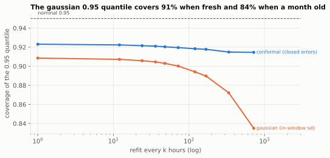
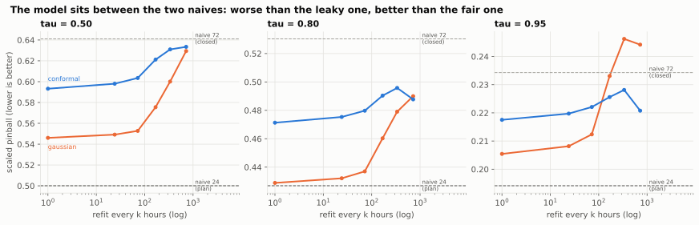

# Block 5: what a day of staleness costs, per served quantile

```bash
uv run w44 freshness        # calibrated DGP, plan reproduced + corrections, about 3 min
uv run w44 real download    # Monash Electricity Hourly (11.8 MB, sha256 checked against the protocol)
uv run w44 real run         # real data, driven by configs/freshness_real.yaml, about 4 min
```

Code: `src/w44_retraining/{freshness,freshness_study,realdata}.py`. Tests: `tests/unit/test_freshness.py`
(closed baseline never reads unclosed actuals, conformal calibration on stationary heavy-tailed noise),
`tests/integration/test_plan_reproduction.py`.

**Business goal.** Turn a retraining cadence into a cost per served quantile, and derive the freshness budget a
contract can sign: the largest cadence `k_max` at which the model still beats the seasonal naive.

## 1. The plan on the calibrated DGP, reproduced

200 series x 2,400 hourly steps (seed 544), same model as block 2 (window 240, profile 24, H = 24, d = 48),
quantiles `mu + z_tau * sd` with `sd` the in-window residual std (the plan's `gaussian` method).

| k | pinball tau=0.50 | tau=0.80 | tau=0.95 | coverage tau=0.95 | refits |
|---|---|---|---|---|---|
| 1 | 0.2544 | 0.1827 | 0.0736 | 0.909 | 2,063 |
| 24 | 0.2579 | 0.1857 | 0.0757 | 0.906 | 85 |
| 168 | 0.2795 | 0.2046 | 0.0888 | 0.890 | 12 |
| 720 | 0.3594 | 0.2782 | 0.1453 | 0.835 | 2 |
| seasonal naive (plan) | 0.2880 | 0.2032 | 0.0758 | 0.948 | |

`k_max` = 168 (tau 0.50), 120 (0.80), 24 (0.95): the plan's "factor 7". Degradation from k = 1 to k = 720: +41%,
+52%, +97%. Stability clause at tau = 0.95: jump p95 from 2.7% (k = 1) to 305.5% (k = 720) of the scale.
Closing-lag illusion at tau = 0.95: +12.5% (k = 24), +9.6% (k = 168). The money table (optimum k = 48, 168, 336,
720 for a refit price of 0.05, 0.50, 2 and 10 EUR) uses the plan's arbitrary volume and margin constants; it
illustrates that the economic optimum moves with the price of compute, nothing more.

## 2. What I correct relative to the plan

### The factor 7 comes from two artefacts

**(a) The tails are under-covered, more so as the model ages.** The 0.95 quantile covers 90.9% at k = 1 and 83.5%
at k = 720: `sd` is an in-window residual std, which ignores that out-of-sample error grows with model age. The
"+97% degradation at tau = 0.95" is mostly a calibration failure. Placing the quantiles at the empirical quantile
of the model's own **closed** errors (`conformal`: per series and lead time, last 240 closed origins, recomputed
every 24 steps) gives a degradation of +19%, +19% and +21% for the three quantiles: nearly the same for all of
them. Coverage at tau = 0.95 stays between 0.915 and 0.923 for every k. Conformal is not perfectly calibrated
either: it is only exact under exchangeability, which level breaks violate.

**(b) The baseline reads actuals that are not closed.** At origin t0 the plan's seasonal naive uses
`y[t0 - 23 .. t0]`, while the model may only use data closed at t0 - 48. The comparison gives the baseline 48 hours
of freshness the model is forbidden. The fair baseline under d = 48 uses lag 72 (`closed_lag(24, 24, 48)`), and is
worse: pinball 0.2994 / 0.2127 / 0.0811 against 0.2880 / 0.2032 / 0.0758. The closing lag is a leak *in favour of
the baseline* here, the mirror of the backtest leak of block 2.

`k_max` per quantile, seed 544, and over seeds 544 to 548:

| quantiles | baseline | tau=0.50 | tau=0.80 | tau=0.95 | ratio 0.50 / 0.95 | seeds, tau=0.95 |
|---|---|---|---|---|---|---|
| gaussian | naive (plan) | 168 | 120 | 24 | 7.0 | 24, 24, 36, 24, 24 |
| gaussian | closed naive | 168 | 168 | 72 | 2.3 | 72 on every seed |
| conformal | naive (plan) | 168 | 168 | 36 | 4.7 | 36, 12, 48, 12, 12 |
| conformal | **closed naive** | **336** | **336** | **168** | **2.0** | 168 on every seed |

On the DGP the freshness budget does depend on the served quantile, by a **factor of about 2**, stable across
seeds, not 7. The direction matches both Zanotti papers (block 1): probabilistic objectives want somewhat more
frequent retraining than point ones (2 weeks against 3 to 4 on M5).

### The stability clause depends on the quantile machinery, not only on the cadence

With conformal quantiles, every cadence meets "jump p95 <= 10%" at tau = 0.95 (2.9% to 8.4% of the scale), but
the recalibration publishes a visible revision on 19% to 45% of origins. With gaussian quantiles only k = 1 meets
the 10% clause. The plan's "(b) stability -> k = 1" is a property of its quantile method.

## 3. Real data: Monash Electricity Hourly

Protocol written and committed before any result: [`configs/freshness_real.yaml`](../configs/freshness_real.yaml)
(commit "Block 5: real-data protocol, written before any result"). 321 hourly series, 2012 to 2014, CC-BY-4.0
([Zenodo 4656140](https://zenodo.org/records/4656140)). Checks at load: same length and start, no missing value,
no negative value; 7 series excluded for more than 10% zeros in the evaluation year (T58, T106, T107, T108, T183,
T299, T300; T183 is all zeros). Evaluated: 314 series, 8,760 hourly origins (2013-12-31 00:00 to 2014-12-30 23:00), pinball scaled per series
by its lag-24 MAE.

| | tau=0.50 | tau=0.80 | tau=0.95 | coverage 0.95 |
|---|---|---|---|---|
| seasonal naive lag 24 (plan, reads unclosed actuals) | 0.5001 | 0.4269 | 0.1941 | 0.945 |
| seasonal naive lag 72 (closed) | 0.6410 | 0.5303 | 0.2343 | 0.938 |
| seasonal naive lag 168 (closed, weekly) | 0.5586 | 0.4654 | 0.2190 | 0.932 |
| model, gaussian, k = 1 | 0.5461 | 0.4289 | 0.2054 | 0.909 |
| model, gaussian, k = 168 | 0.5755 | 0.4603 | 0.2331 | 0.894 |
| model, gaussian, k = 720 | 0.6294 | 0.4900 | 0.2442 | 0.895 |
| model, conformal, k = 1 | 0.5932 | 0.4713 | 0.2175 | 0.909 |
| model, conformal, k = 720 | 0.6334 | 0.4877 | 0.2208 | 0.909 |

The model is served from 240 origins before the evaluation, which only collect closed errors for the conformal
quantiles (the protocol's warm-up) and are not scored.

`k_max` (full year; then four consecutive quarters of 2,190 origins):

| quantiles | baseline | full year (0.50 / 0.80 / 0.95) | quarters |
|---|---|---|---|
| gaussian | naive (plan) | 0 / 0 / 0 | Q1 0/336/168, Q2 0/0/0, Q3 0/0/0, Q4 0/168/72 |
| gaussian | closed naive | 720 / 720 / 168 | Q1 720/720/720, Q2 720/720/0, Q3 720/720/72, Q4 336/720/336 |
| conformal | naive (plan) | 0 / 0 / 0 | Q1 0/720/720, Q2 0/0/0, Q3 0/0/0, Q4 0/0/336 |
| conformal | closed naive | 720 / 720 / 720 | Q1 720 x3, Q2 0 x3, Q3 720 x3, Q4 336/720/720 |

**Verdict.** The protocol's decision rule, applied as written (conformal quantiles, `k_max` against
`seasonal_naive_24`), gives **NEITHER**: the ratio is undefined because the model never beats that baseline at the
median, at any cadence, in any quarter. The closed lag-72 naive is **a deviation from the protocol**, added after
it was written because block 5 found the lag-24 naive reads unclosed actuals. Against it, the same rule gives a
ratio of 1.0 on the full year (and 1.0, undefined, 1.0, 0.5 by quarter): **CONTRADICTED**. I report both; only
the first is the pre-registered verdict.

What the real data says:

1. **Against a baseline that reads the freshest actuals, no cadence wins.** On electricity load, the lag-24 naive
   is so strong that 48 hours of extra freshness beat any retraining of a 24-hour-profile model, at the median and
   on most of the year. A backtest that forgets the closing lag *for the baseline* concludes the model is useless;
   one that forgets it for the model concludes it is better than it is (+12.8% at tau = 0.95, k = 24).
2. **Against the fair baseline, the quantile dependence is weak with calibrated quantiles and unstable without.**
   Conformal: 720 h at every quantile. Gaussian: 720 h at the median and 168 h at tau = 0.95 (ratio 4.3), but a
   first run whose refits were simply phased differently (the schedule started 240 h later) gave 336 / 336 / 168
   (ratio 2). A `k_max` that moves by a factor 2 when the refit calendar is shifted is not a contract number.
3. **Quarter 2 breaks everything.** From about April to June 2014, the model loses to the closed naive at every
   cadence with conformal quantiles, and at tau = 0.95 with gaussian ones. The contract should carry the
   quarterly range and a fallback, not a point.
4. **A weekly cycle matters for a sixth of the series, not for the median one.** The average week of the median
   series is flat (weekend load 1% from weekday load), but 52 series (17%) have weekends at least 10% lower and 11
   (4%) at least 10% higher. Those series carry the edge of the closed weekly naive (0.5586 at the median) over the
   lag-72 naive (0.6410): its pinball is 45% lower on the first group and 4% lower on flat-week series
   (correlation -0.64 between weekend ratio and gain). The model, with a 24-hour profile, shares the lag-72 naive's
   blind spot on that minority; a weekly profile for them is likely a bigger lever than the cadence.
5. **Neither quantile method is calibrated** (about 0.91 coverage for a 0.95 quantile at every cadence). Conformal
   on closed errors keeps coverage flat with model age (0.909 at k = 1 and at k = 720, against 0.909 to 0.895 for
   gaussian), not at its nominal level: errors are not exchangeable over a year of load data.
6. **Stability at tau = 0.95.** Gaussian: jump p95 from 4.6% (k = 1) to 54% (k = 24) and more than 100% beyond;
   conformal: 5.6% to 9.8% at every cadence, but 30% to 59% of origins carry a visible revision.

## Notebooks

- [`notebooks/01_quantiles_and_freshness.ipynb`](notebooks/01_quantiles_and_freshness.ipynb): quantile forecasts
  and the pinball loss from scratch, the plan's chain reproduced, then the two artefacts (tail under-coverage,
  baseline reading unclosed data) isolated one at a time, and the stability clause per quantile method.
- [`notebooks/02_real_data.ipynb`](notebooks/02_real_data.ipynb): the protocol and data checks, what the electricity
  series look like (daily cycle, weekly cycle for a sixth of them), scores against three baselines, the
  pre-registered verdict and the deviation, and the refit-phase fragility of `k_max` (re-run inside the notebook).
  Reads `data/results/real_study.pkl`: run `make real` first.






## Definition of done

- [x] The plan's DGP figures reproduce to the printed digit (integration test).
- [x] Each correction is measured, with seeds (DGP) or quarters (real data).
- [x] Real data run under a protocol committed before the results; its decision rule applied as written (NEITHER),
      and the closed-baseline variant reported separately as a deviation.
