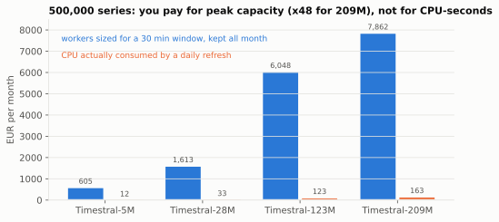
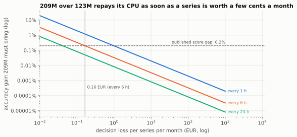

# Block 6: choosing a TSFM size by its serving cost

```bash
uv run w44 serving          # under 1 s
```

Code: `src/w44_retraining/serving.py`. Tests: `tests/unit/test_serving_realdata.py`.

## Inputs, and how each one is known

| Model | Parameters | CPU latency (8 threads) | fp32 weights | Latency source |
|---|---|---|---|---|
| Timestral-5M | 5M | 10 ms | 21 MB | published |
| Timestral-28M | 28M | 28 ms | 111 MB | derived: "five times faster" than 209M |
| Timestral-123M | 123M | 105 ms | 490 MB | derived: "three quarters of its latency" |
| Timestral-209M | 209M | 140 ms | 837 MB | published |

The published workload is one day ahead from three weeks of 15-minute history (2,016-step context, 96-step
horizon). The CPU price (0.035 EUR per vCPU-hour) is declared, not measured. The only published accuracy figure
is that 123M comes "within 0.2% of the 209M score" on the benchmarks.

## Results (the plan's figures reproduce)

**Consumed CPU is negligible.** Refreshing 500,000 series every hour with the 209M costs 3,920 EUR a month of
CPU-seconds; daily, 163 EUR.

**Break-even of 209M over 123M** (20,000 series, refresh every 6 h): the 209M repays its +33% CPU only if the
decision loss exceeds 0.16 EUR per series per month, *assuming the 0.2% benchmark gap is a 0.2% gap in decision
loss*.

**The compute window is what you pay for.** To refresh 500,000 series in a 30-minute nightly window you need 3
(5M), 8 (28M), 30 (123M) or 39 (209M) 8-vCPU workers: 209M needs 30% more workers than 123M, and 13 times more
than 5M. If those workers are kept all month, they cost **7,862 EUR for the 209M, against 163 EUR of CPU actually
consumed** by a daily refresh, a factor of 48. The bill is set by peak capacity, not by CPU-seconds, unless the
platform scales to zero between windows.

**Against the classic model of block 2.** Measured on this machine (numpy, vectorised over 2,000 series): 0.0008 to
0.0016 ms per series depending on the run (shared machine) for a refit and a forecast. At 1 EUR of decision loss per series per month, a TSFM must beat it by 0.03%
(28M) or 0.13% (209M) to repay its CPU at a 6-hour cadence: compute is not the argument against a TSFM, accuracy
and licence are.

**Licence gate, with the licence read at the source (block 1).**

| Weights | Client revenue unknown | 5M USD / month | 50M USD / month |
|---|---|---|---|
| Timestral (Modified MIT, 20M USD/month cap) | REFUSE | ALLOW, re-check monthly | REFUSE |
| Chronos-2 (Apache-2.0) | ALLOW | ALLOW | ALLOW |
| any licence not read at the source | REFUSE | REFUSE | REFUSE |

## Notebook

- [`notebooks/01_serving_cost.ipynb`](notebooks/01_serving_cost.ipynb): where each input comes from, CPU consumed vs
  capacity provisioned for a batch window, the break-even accuracy gain of 209M over 123M as a function of the
  decision loss, the measured classic-model latency, and the licence gate as a function of client revenue.





## What I correct relative to the plan

1. **"Licence gate: the four sizes REFUSED"** was the right default with an unread licence. Read at the source,
   the gate is a function of the client: Timestral is usable below 20M USD of monthly revenue (company *or
   employer*), derivatives included, and forbidden above. A gate that refuses everything and a gate that reads
   "Modified MIT" as MIT are both wrong; `licence_gate(family, client_revenue)` encodes the clause.
2. **The 0.2% is a benchmark score gap, not a decision-loss gain.** The break-even threshold (0.16 EUR per series
   per month) holds only under that equivalence; the plan presents it as a fact. On a client's data the gap
   between 123M and 209M has to be measured, and may be larger or smaller than 0.2%.
3. **"The binding constraint is the compute window" needed its euro figure.** Worker counts and CPU-seconds are
   the same quantity unless capacity is provisioned for the peak. The point holds, and the figure that makes it is
   provisioned cost against consumed cost (x48 for the 209M at 500,000 series), which the plan does not compute.
4. **The classic model's latency was declared (0.08 ms); measured, it is 0.0008 to 0.0016 ms per series.** This changes no
   conclusion: the TSFM's cost dominates either way.
5. **Latency transfer is an assumption.** The published latencies are for a 2,016-step context and 96-step
   horizon. An hourly park with a 24-step horizon and a 504-step context will not have the same latency. All costs
   here hold for the published workload; on a client's park they have to be measured.
6. **Chronos-2 is a real alternative.** It is Apache-2.0 for code and weights, with 119.5M parameters. The 28M
   Timestral beats it on GIFT-Eval and TIME per the announcement, but for a client above the revenue cap,
   Chronos-2 is the open option.
